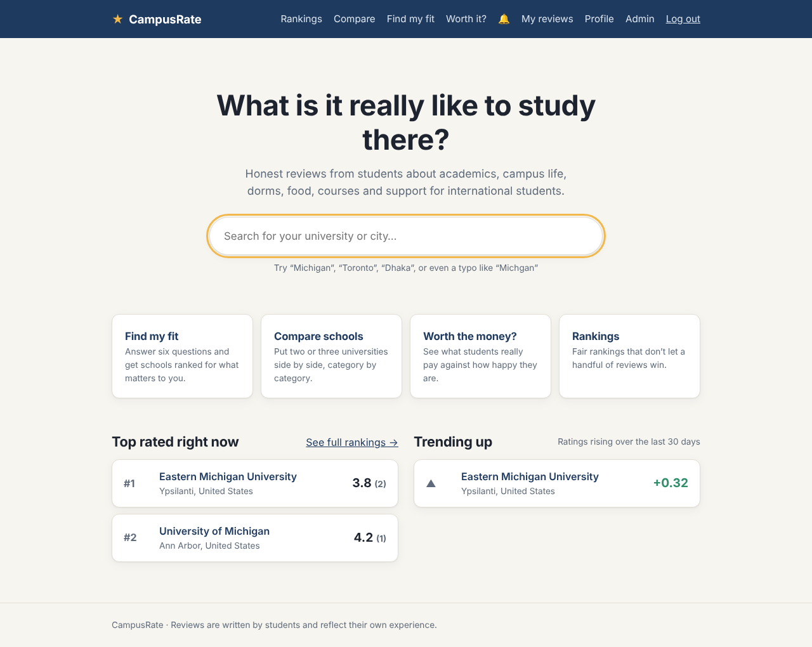
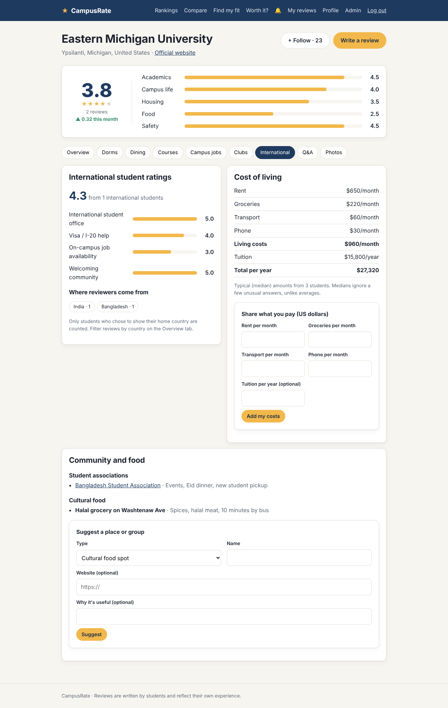
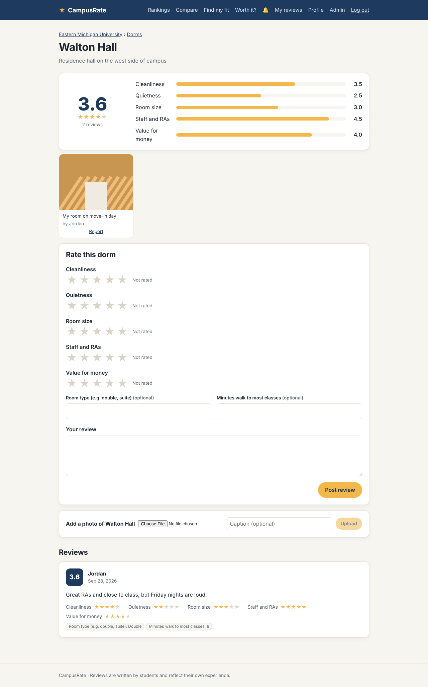
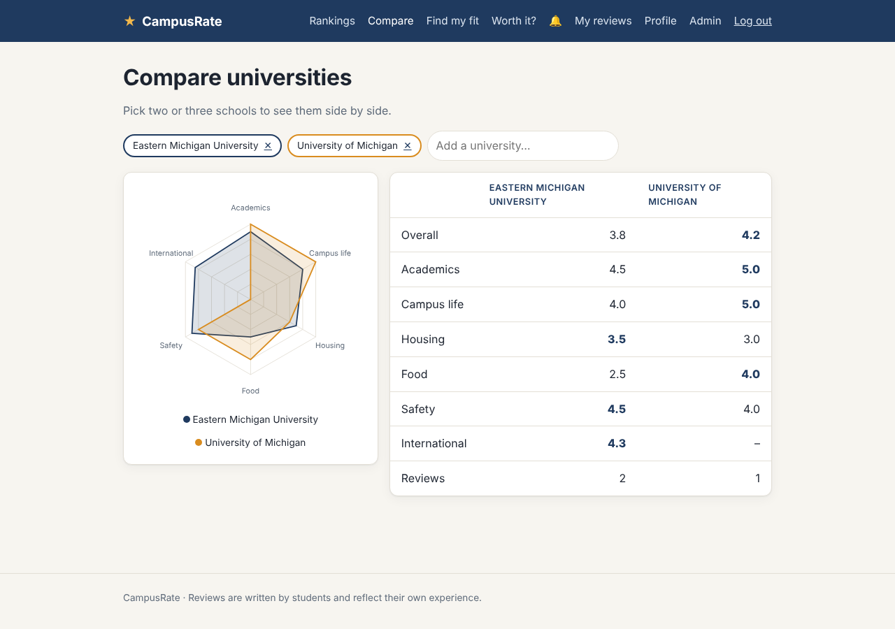
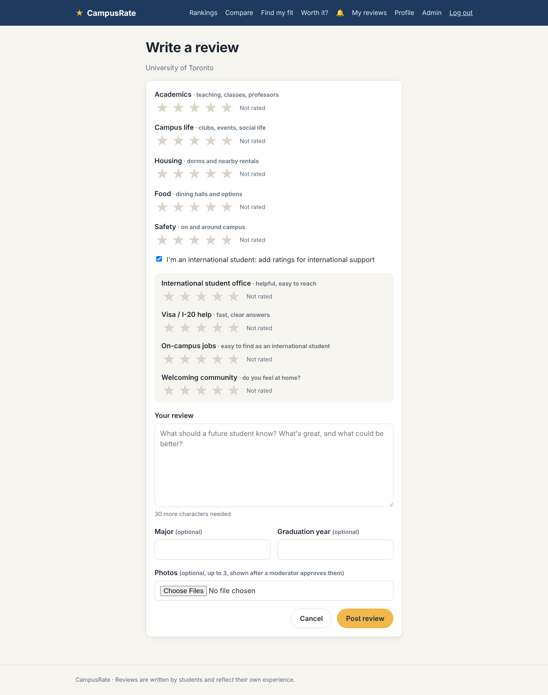

# CampusRate

Honest student reviews of universities, from the whole school down to the dorm, the dining hall and the course, with features built for international students.

**Stack:** React · JavaScript · HTML/CSS · Java 21 · Spring Boot 3 · MySQL 8

Nothing else: no outside AI service, no chart or map library, no Redis or search engine. The "smart" features (review insights, sentiment, search with typos, fake-review detection) are written in plain Java, and the charts are hand-drawn SVG in React.


| Home | International tab | Dorm page |
| --- | --- | --- |
|  |  |  |

| Compare | Admin dashboard | Review form |
| --- | --- | --- |
|  |  |  |

*(Screenshots use sample data.)*

---

## Features

**Reviews and rankings**
- Search with autocomplete that tolerates typos ("michgan" → Michigan) and initials ("mit", "buet")
- University pages with five category scores, reviews sortable by newest / most helpful / highest / lowest
- Student-only sign up with a university email; one review per student per school; "helpful" votes
- Fair rankings with a Bayesian average, by category (including international support) and country

**Inside each university** (dorms, dining halls, courses, campus jobs, clubs)
- Each type has its own rating questions (a dorm has "Quietness", a job has "Pay") and extra details (hourly pay, room type, meal)
- "What's good today": dining reviews from the last 24 hours
- Students can suggest missing places; admins approve them

**Built for international students**
- Optional ratings for the international office, visa/I-20 help, on-campus jobs and how welcoming the community is
- Filter reviews by "international students only" or by home country (only for students who choose to show it)
- Cost of living from student reports, shown as medians, plus cultural food spots and student associations

**Smart features (plain Java)**
- *At a glance* summary: best and worst categories, overall mood, and the most typical praise and complaints quoted from real reviews
- Sentiment score for every review, charted per semester
- *Ask the reviews*: type a question, get the review sentences that answer it, with links back to each review (TF-IDF retrieval)
- *Find my fit* quiz: schools ranked by the categories you care about, within your budget
- Fake-review rules: bursts of reviews, copied text, brand-new accounts giving all 1s or all 5s; flagged reviews are hidden until an admin checks them

**Community**
- Q&A per school, with upvotes and reputation points
- Badges: current student, alumni, transfer, international, home country, reputation
- Follow a school; a weekly background job sends a digest notification; answer notifications
- Photo uploads (campus gallery, places, reviews) with moderation and reporting

**Data and visuals**
- Campus map (OpenStreetMap embed), compare page with a radar chart, "worth the money" scatter chart, trending schools

**Engineering**
- Layered Spring Boot backend, Flyway migrations, JWT auth with roles, BCrypt
- In-memory caching of rankings, school pages and insights, cleared whenever a review changes
- Rate limiting (sliding window per user / IP) and a honeypot field against bots
- Scheduled jobs: trending (hourly), weekly digest, search index refresh
- Admin dashboard: stats, reviews-per-day chart, moderation queues
- Unit tests (JUnit, Mockito) and integration tests against MySQL, run by GitHub Actions

## Architecture

```
React (Vite)  ──HTTPS + JWT──▶  Spring Boot REST API  ──JPA / JdbcClient──▶  MySQL
                                 controller → service → repository           uploads/ (photo files)
```

```
backend/src/main/java/com/campusrate/
├── controller/   HTTP endpoints only: read the request, call a service, return JSON
├── service/      Business logic: reviews, rankings, places, Q&A, photos, insights, admin …
├── text/         Plain-Java text tools: sentiment, TF-IDF search, similarity, edit distance
├── repository/   JPA repositories for the core entities
├── model/        Entities (User, University, Review, ReviewVote) and the PlaceType definitions
├── dto/          Request/response shapes, so entities (and password hashes) never leave the server
├── security/     JWT, the auth filter and the rate limiter
├── config/       Security rules, CORS, caching, scheduling
└── exception/    One JSON error format for the whole API
backend/src/main/resources/db/migration/   Flyway SQL migrations (V1 … V4)

frontend/src/
├── api.js            Every backend call in one place (built-in fetch)
├── AuthContext.jsx   Who is logged in, plus unread notifications
├── components/       Navbar, search, review card, stars, SVG charts, photos, badges
└── pages/            Home, university (with tabs), place, question, rankings, compare,
                      find my fit, worth it, profile, notifications, admin, auth
```

The core entities (users, universities, reviews, votes) use **JPA**. The newer features use **JdbcClient with hand-written SQL**, which suits their many small, specific queries; both share the same transactions.

### Database

| Table | Purpose |
| --- | --- |
| `users` | Email, BCrypt hash, role, student status, international flag, home country (private unless shown), reputation |
| `universities` | School info, map position, stored averages, international score, trend |
| `reviews` | Five ratings, optional four international ratings, text, sentiment, status (PUBLISHED / FLAGGED / REMOVED); `UNIQUE (user_id, university_id)` |
| `review_votes`, `review_flags` | Helpful votes; why a review was flagged |
| `places`, `place_reviews` | Dorms, dining, courses, jobs, clubs in one table; type-specific ratings stored as JSON |
| `photos`, `photo_reports` | Uploaded image file names and moderation status; one report per student per photo |
| `cost_reports`, `community_links` | Living costs; cultural food spots and associations |
| `questions`, `answers`, `answer_votes` | Q&A |
| `follows`, `notifications` | Following schools; in-app notifications |

## Running it locally

You need **Java 21**, **Maven**, **Node.js 20+** and **MySQL 8**.

### 1. Start MySQL

The app creates the `campusrate` database itself. It connects as `root` with password `password` by default; to use your own, set `DB_USERNAME` and `DB_PASSWORD`.

### 2. Start the backend

```bash
cd backend
ADMIN_EMAILS=you@youruniversity.edu mvn spring-boot:run
```

The API runs at http://localhost:8081 (check http://localhost:8081/api/health). On start, Flyway creates or upgrades the tables and adds 39 universities plus a few starter places at Eastern Michigan University.

`ADMIN_EMAILS` makes that account an admin when it signs up or logs in (log out and back in if the account already exists). Uploaded photos are saved in `backend/uploads/`.

### 3. Start the frontend

```bash
cd frontend
npm install
npm run dev
```

Open http://localhost:5173.

### 4. Run the tests

```bash
cd backend
mvn test
```

MySQL must be running. The integration tests use a separate `campusrate_test` database that they create and wipe themselves. GitHub Actions starts its own MySQL and runs the tests on every push.

## API

| Method | Endpoint | Login? | What it does |
| --- | --- | --- | --- |
| POST | `/api/auth/register`, `/api/auth/login` | No | Sign up / log in, returns a JWT |
| GET, PUT | `/api/me/profile` | Yes | Your profile (status, international, home country) |
| GET | `/api/me/reviews`, `/api/me/notifications` | Yes | Your reviews; your notifications |
| POST | `/api/me/notifications/read` | Yes | Mark notifications read |
| GET | `/api/universities?query=` | No | Search (typos allowed) |
| GET | `/api/universities/{id}` | No | School details and averages |
| GET | `/api/universities/{id}/reviews?sort=&page=&international=&country=` | No | Reviews, 10 per page |
| GET | `/api/universities/{id}/insights` | No | Summary, typical quotes, sentiment per semester |
| GET | `/api/universities/{id}/ask?q=` | No | Review sentences that answer a question |
| GET | `/api/universities/{id}/international` | No | International ratings, countries, costs, links |
| POST | `/api/universities/{id}/costs`, `/links` | Yes | Report living costs; suggest a food spot / association |
| GET, POST | `/api/universities/{id}/follow` | Read: no | Follow status; follow / unfollow |
| GET, POST | `/api/universities/{id}/places?type=` | Write: yes | Dorms, dining, courses, jobs, clubs; suggest one |
| GET | `/api/universities/{id}/dining/today` | No | Dining reviews from the last 24 hours |
| GET, POST | `/api/universities/{id}/questions` | Write: yes | Q&A list; ask |
| GET, POST | `/api/universities/{id}/photos` | Write: yes | Gallery; upload (multipart) |
| GET | `/api/place-types` | No | Rating questions for each place type |
| GET | `/api/places/{id}` | No | A place with its reviews and photos |
| POST | `/api/places/{id}/reviews` | Yes | Review a place |
| GET | `/api/questions/{id}` | No | Question with answers |
| POST | `/api/questions/{id}/answers`, `/api/answers/{id}/vote` | Yes | Answer; upvote an answer |
| POST | `/api/reviews`, PUT/DELETE `/api/reviews/{id}` | Yes | Write, edit (author), delete (author) |
| POST | `/api/reviews/{id}/helpful`, `/api/photos/{id}/report` | Yes | Helpful vote; report a photo |
| GET | `/api/rankings?category=&country=` | No | Bayesian-ranked list |
| GET | `/api/compare?ids=1,2,3` | No | Schools side by side |
| GET | `/api/explore/trending`, `/api/explore/value` | No | Rising schools; cost vs. rating |
| POST | `/api/fit` | No | Find-my-fit quiz results |
| GET | `/api/files/{name}` | No | Serves an uploaded photo |
| GET | `/api/admin/stats`, `/flags`, `/pending` | Admin | Dashboard numbers and moderation queues |
| POST | `/api/admin/{reviews\|photos\|places\|links}/{id}/{approve\|remove\|reject}` | Admin | Moderate |
| POST | `/api/admin/digest` | Admin | Send the weekly digest now |

Errors always look like `{ "status": 400, "message": "...", "fields": { "body": "..." } }`. Too many requests in a short time returns `429`.

## Design decisions (interview notes)

**Bayesian ranking.** `score = (C·m + Σratings) / (C + n)`, with `m` the site-wide average, `n` the school's review count and `C = 10`. Few reviews keep a school near `m`; many let its own average take over. See `RankingService`.

**Stored averages, updated transactionally.** A school's averages live in `universities` and are recalculated with aggregate SQL inside the same `@Transactional` method that saves the review. Pages read precomputed numbers, and both changes commit or roll back together.

**Caching with correct invalidation.** Rankings, school pages and insights are cached in memory (`@Cacheable`) and cleared (`@CacheEvict`) whenever a review changes, so they're fast and never stale. With several servers this would move to a shared cache.

**One generic design for five place types.** Dorms, dining halls, courses, jobs and clubs share one table, one service and one controller. `PlaceType` defines each type's rating questions; the backend validates against it and React builds its forms from `GET /api/place-types`, so a new type is a one-file change.

**Text features without an AI service.** A lexicon sentiment analyzer handles negation ("not good"), intensifiers ("very") and "but" clauses. "Ask the reviews" ranks review sentences by TF-IDF cosine similarity, the retrieval half of RAG. Answers are always quotes from real students, so nothing is made up, and a school's few hundred sentences are indexed in milliseconds without a vector database.

**Typo-tolerant search.** An in-memory index scores schools by exact match, initials, city, then per-word prefix or Levenshtein edit distance (1 typo for words of 4+ letters, 2 for 7+), computed with two-row dynamic programming that stops early.

**Fake-review detection.** Explainable rules: burst of reviews for one school in an hour, Jaccard similarity of 3-word shingles against recent reviews, and brand-new accounts giving all 1s or 5s. Flagged reviews are saved but hidden and excluded from averages until an admin decides.

**Concurrency.** One review per student per school is enforced by a database `UNIQUE` key, not just a check in Java. Reputation changes are single atomic SQL updates (`reputation = reputation + 1`), and that column is read-only to JPA so a stale entity can never overwrite it.

**Security.** Stateless JWT with roles (`/api/admin/**` needs ADMIN, re-checked against the database), BCrypt passwords, the same error for unknown email and wrong password, a sliding-window rate limiter, a honeypot field, and photo uploads checked by their first bytes, stored under random names, and served only by names matching a strict pattern.

**Background jobs.** `@Scheduled` jobs recompute trends hourly and send the weekly digest, so heavy work never slows down a page someone is loading.

**Privacy.** Home country is hidden unless the student opts in, and only opted-in students are counted in the country breakdown.

## Deploying

- **Database:** a managed MySQL. Set `DB_URL`, `DB_USERNAME`, `DB_PASSWORD`.
- **Backend:** Render or Railway, built with `mvn package`. Also set `JWT_SECRET` (32+ random characters), `FRONTEND_URL`, `ADMIN_EMAILS`, and `UPLOAD_DIR` pointing at a persistent disk (otherwise photos disappear on redeploy).
- **Frontend:** Vercel or Netlify. Set `VITE_API_URL` to your backend's `/api` address.

## Ideas for later

- Email verification and email delivery of notifications
- Machine-learning sentiment model, and an LLM to write summaries from the retrieved quotes
- Move photos to cloud storage and the cache to a shared store when running several servers
